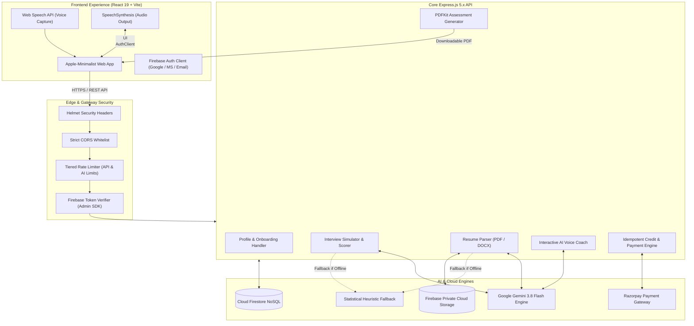
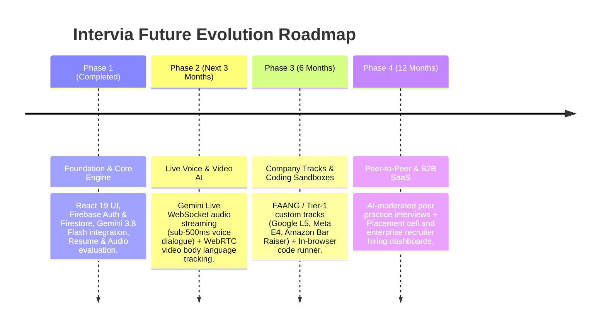

# Intervia — AI-Powered Interview Preparation Platform
> **Complete Project Blueprint, Architecture Guide & Pitch Deck**  
> *Everything you need to understand, explain, pitch, and scale the Intervia platform.*

---

## 📌 Executive Summary (The Elevator Pitch)

### 💡 The 30-Second Pitch
> *"Job seekers often spend weeks submitting resumes, only to freeze or fail during the actual interview because they never practiced out loud under realistic pressure. **Intervia** is an AI-powered interview copilot that transforms passive preparation into active mastery. It audits your resume, generates role-specific interview questions on the fly, listens to your spoken answers in real time, grades you across 4 key dimensions (Relevance, Clarity, Poise, and Depth), and gives you actionable feedback with model answers. It’s like having a Principal Tech Lead and HR Director in your pocket 24/7."*

### 🎯 The Core Problem & Intervia's Solution

| The Traditional Problem | How Intervia Solves It |
| :--- | :--- |
| **Generic Question Banks**: Static lists of LeetCode or top-50 questions don't match the specific role, experience level, or tech stack being targeted. | **Adaptive AI Generation**: Leverages Google Gemini 3.8 Flash to dynamically generate industry-calibrated technical and behavioral questions tailored to exact roles. |
| **Silent Solo Prep**: Candidates practice by typing or reading in their head, leaving them unprepared for verbal articulation and filler words. | **Spoken Voice Practice**: Real-time voice capture evaluates speech fluency, filler words (*"um"*, *"like"*), sentence pacing, and structured STAR storytelling. |
| **Vague Feedback**: Rejection emails never explain *why* an answer wasn't good enough. | **Multi-Pillar Rubric Scoring**: Clear, objective ratings on Relevance, Clarity, Confidence, and Technical Depth, accompanied by executive critiques and ideal model answers. |
| **Resume Disconnect**: Most interviewers ask questions based on candidate resumes, but candidates prep independently of their CV. | **Resume Intelligence Engine**: Analyzes uploaded PDFs/Word docs, measures outcome metrics, checks ATS keywords, and suggests targeted improvements. |
| **Privacy & Cost Concerns**: Many AI tools leak user resumes or lock everything behind expensive recurring subscriptions. | **Privacy-First & Credit-Based**: Users maintain full data ownership with explicit AI consent, GDPR data export/deletion, and pay-as-you-go credit packs. |

---

## 🏛️ System Architecture at a Glance

The following diagram illustrates how data flows securely from the candidate's browser to the backend services, AI models, and databases:



---

## 🧩 Deep Dive: Every Component Explained in Simple Terms

### 1. User Interface & Frontend Experience (`frontend/`)
- **Technology Stack**: React 19, Vite 8, Tailwind CSS v4, Vanilla CSS animations.
- **Design Language**: Apple-inspired minimalist aesthetic. Sleek dark-mode palette, clean typography, glowing score rings, and smooth micro-animations.
- **Key Modules**:
  1. **Practice Dashboard**: Real-time overview of available credits, completed sessions, questions answered, upcoming interview countdown, and complete practice history.
  2. **Interactive Mock Interview Room**:
     - Mode selection: **Technical** (System design, algorithms, architecture) vs. **HR / Behavioral** (Leadership, conflict resolution, culture fit).
     - Difficulty dial: **Easy**, **Medium**, or **Hard**.
     - Audio recording toggle with live speech transcription and real-time timer.
     - Live rubric breakdown showing 4-pillar scores and model answers.
  3. **Resume Intelligence Audit**:
     - Upload zone accepting PDF, DOCX, or direct text paste.
     - Transparent consent checkbox requiring user approval before AI processing.
     - Interactive multi-tab score card highlighting strengths, missing metrics, and ATS keywords.
  4. **AI Voice Coach Lounge**:
     - Conversational partner with speech synthesis (the AI speaks answers out loud) and audio recognition.
     - Adapts to your target role, experience level, and coaching tone preferences.
  5. **Credit Store**:
     - Clear pricing tiers with localized INR conversion for seamless test/production checkout.
  6. **Data Privacy & Account Settings**:
     - Instant JSON data export and one-click account deletion complying with GDPR "Right to be Forgotten".

---

### 2. Backend API & Security Layer (`backend/server.js`)
- **Technology Stack**: Node.js, Express 5.x, Helmet, CORS, Express-Rate-Limit.
- **Security & Privacy Safeguards**:
  - **Firebase ID Token Verification**: Every private API request validates cryptographic JWT tokens using the Firebase Admin SDK. Requests are strictly scoped to the authenticated user's ID (`req.user.id`).
  - **Prompt Injection Defense**: All user inputs (candidate answers, resume text) are treated as untrusted data in AI prompts to prevent model jailbreaking.
  - **Multi-Tier Rate Limiting**:
    - General API limit: 300 requests per 15 minutes.
    - AI operation limit: 12 requests per minute (prevents spam and quota exhaustion).
  - **Zero Data Leakage**: No resume files, auth tokens, or payment secrets are ever dumped into plaintext logs.

---

### 3. AI Intelligence Layer (`@google/genai`)
- **Primary Engine**: **Google Gemini 3.8 Flash** (`gemini-3.8-flash`).
- **Why Gemini 3.8 Flash?**
  - Ultra-low latency for interactive coaching.
  - High reasoning capability for evaluating code, architecture, and behavioral psychology.
  - Native JSON schema mode ensuring predictable, crash-proof responses.
- **Dual-Engine Architecture (Zero-Downtime Guarantee)**:
  - If the Gemini API key is missing, network fails, or quota limits are reached, Intervia **automatically falls back to a deterministic heuristic engine**.
  - Users are never met with a broken screen or generic crash; the platform gracefully evaluates speech cadence, vocabulary, and structural completeness offline.

---

### 4. Spoken Answer Evaluation & 4-Pillar Scoring
When a candidate speaks or types an answer, Intervia runs a multi-step evaluation:

```
[Candidate Spoken Answer]
          │
          ├──► 1. Speech Cadence & Fluency Analysis (Word count, sentence structure)
          ├──► 2. Filler Word Detection ("um", "uh", "literally", "like", "you know")
          ├──► 3. Technical & Domain Keyword Extraction (Microservices, Redis, ACID, etc.)
          ├──► 4. Behavioral STAR Framework Check (Situation, Task, Action, Result)
          └──► 5. Gemini 3.8 Flash Rubric Scoring (0 - 100 on 4 Dimensions)
```

The 4 Scoring Dimensions:
1. **Relevance (0-100)**: Did the candidate answer the exact question asked, or did they deflect?
2. **Clarity (0-100)**: Was the explanation concise, articulate, and well-structured?
3. **Poise & Confidence (0-100)**: Tone of voice, professional communication style, and minimal filler words.
4. **Technical Depth (0-100)**: Discussion of trade-offs, edge cases, real-world constraints, and architectural nuances.

**Deliverables provided per answer**:
- Overall Score & Verdict (*"Strong response"*, *"Solid response"*, *"Building"*, or *"Needs practice"*).
- Specific strengths (what went well).
- Actionable improvements (concrete changes to make next time).
- **Ideal Model Answer**: A concise, master-level example showing how a top 1% candidate answers that exact question.

---

### 5. Resume Intelligence & Document Parsing
- **Multi-Format Ingestion**: Supports `.pdf` (via `pdf-parse`), `.docx` (via `mammoth`), and `.txt`.
- **Private Cloud Storage**: Original resume files are kept strictly isolated in private Firebase Cloud Storage (or the local Firebase Storage Emulator during development). Direct browser access is blocked.
- **Detailed Audit Deliverables**:
  - **Impact & Metrics Score**: Detects whether accomplishments have quantified numbers (e.g., *"reduced latency by 40%"* vs. *"improved speed"*).
  - **Skills Coverage**: Evaluates technical stack match for target job titles.
  - **Experience & Structure**: Checks for clean reverse-chronological layout and outcome-driven bullet points.
  - **ATS Keywords & Suggested Roles**: Recommends missing industry keywords that help resumes pass recruiter screening filters.

---

### 6. PDF Report Generator (`pdfkit`)
- Generates a polished, professional multi-page assessment report on demand.
- Includes candidate metadata, overall percentage, score comparison bars, individual question breakdowns, AI critiques, and a cryptographic verification badge.
- Perfect for candidates to review offline or share with career mentors.

---

### 7. Monetization & Idempotent Credit Ledger
- **Credit Model**:
  - Mock Interview Session (5 questions): **10 credits**
  - Complete Resume Audit: **20 credits**
  - AI Voice Coach Chat: **5 credits**
- **Razorpay Integration**:
  - Server-priced order creation prevents frontend price tampering.
  - HMAC-SHA256 signature verification guarantees transaction authenticity.
  - **Idempotent Ledger**: Double-charging or duplicate credit grants are mathematically impossible due to unique event keys and atomic database operations.

---

## 🛠️ Technology Stack Summary

| Layer | Technologies Used | Purpose |
| :--- | :--- | :--- |
| **Frontend** | React 19, Vite 8, Tailwind CSS v4, Web Speech API | Ultra-fast UI, modern design, voice recording & playback |
| **Backend** | Node.js, Express 5.x, Helmet, CORS, Multer | Secure RESTful API, file uploads, rate limiting |
| **AI / ML** | Google Gemini 3.8 Flash (`@google/genai`) | Adaptive question generation, answer evaluation, resume analysis |
| **Database** | Google Cloud Firestore (NoSQL) | User profiles, consent records, interview answers, credit ledger |
| **Storage** | Cloud Storage for Firebase / Local Storage Emulator | Secure, private storage for resume files and extracted text |
| **Auth** | Firebase Authentication (OAuth & Email) | Secure login with Google, Microsoft, and email verification |
| **Document Processing** | `pdf-parse`, `mammoth`, `pdfkit` | PDF/DOCX text extraction and dynamic PDF report generation |
| **Payments** | Razorpay SDK, Crypto (HMAC-SHA256) | Server-side verified credit purchases with tamper protection |

---

## 🔮 Future Goals & Roadmap Vision

Here is the strategic plan to evolve Intervia from an advanced interview prep tool into the world's leading Career Intelligence Platform:



### 1. Ultra-Low Latency Conversational Voice (Gemini Live API)
- **Current State**: Turn-based audio recording and playback.
- **Future Vision**: Bidirectional streaming over WebSockets using the Gemini Multimodal Live API. The AI interviewer will converse naturally with sub-500ms response times, allow candidates to interrupt mid-sentence, and challenge answers dynamically just like a real human interviewer.

### 2. Video & Computer Vision Body Language Analysis
- **Implementation**: WebRTC stream evaluated via MediaPipe / computer vision models.
- **Capabilities**:
  - **Eye Contact Tracking**: Notifies candidates if they look away from the camera too often.
  - **Facial Expression & Nervous Ticks**: Identifies signs of anxiety, excessive blinking, or stiff posture.
  - **Audio Pitch & Vocal Variety**: Measures vocal modulation to ensure candidates sound confident and enthusiastic rather than monotone.

### 3. Company-Calibrated Interview Tracks
- Curated prep tracks calibrated to the exact rubrics of top tech firms:
  - **Google Track**: Emphasis on algorithm efficiency, edge cases, and "Googliness".
  - **Amazon Track**: Deep dive into the 16 Leadership Principles with strict STAR format verification.
  - **Meta Track**: Fast-paced architectural trade-offs and rapid coding execution.
  - **Stripe / FinTech Track**: Correctness, precision, distributed transactions, and idempotency.

### 4. Interactive In-Browser Coding Canvas
- Embedded Monaco Editor (VS Code engine) with a secure, sandboxed WebAssembly execution environment.
- Allows candidates to write, run, and debug algorithms while explaining their thought process out loud to the AI interviewer.

### 5. Collaborative Peer-to-Peer Mock Interviews with AI Referee
- Matches candidates anonymously based on target role and timezone.
- One candidate interviews the other using AI-generated rubrics, while Intervia's AI serves as a "silent shadow referee" that grades both the interviewer and the interviewee.

### 6. B2B Enterprise & University Placement Platform
- **University Placement Cells**: Real-time batch analytics tracking student readiness, weak competency areas, and resume quality before campus placements.
- **Recruitment Screening (AI First-Round Interviews)**: Companies can deploy custom branded Intervia bots to conduct automated first-round screening interviews, reducing hiring costs by 80%.

---

## 🎤 How to Pitch Intervia (Presentation Guide)

When pitching Intervia to investors, recruiters, hackathon judges, or university panels, use this structured narrative:

### 1. The Hook (Start with a relatable story)
> *"Everyone in this room has experienced the dread of a job interview. You've spent hours polishing your resume, but the second the interviewer asks: 'Tell me about a time you had a catastrophic production outage,' your mind goes blank, your voice shakes, and you ramble for four minutes. Why? Because reading interview questions is not the same as saying them out loud."*

### 2. The Solution (Introduce Intervia)
> *"That is why we built **Intervia**. Intervia is an end-to-end AI interview copilot that simulates real-world hiring loops. It analyzes your resume, customizes questions for your target seniority, listens to your verbal responses, and gives you actionable multi-dimensional feedback before you step into the real interview room."*

### 3. The Unfair Advantages (Why we win)
- **Full Spectrum Practice**: We don't just test coding or just resume formatting; we combine resume audits, speech cadence analysis, system design, and behavioral storytelling in one unified workflow.
- **Architected for Enterprise Privacy**: We use owner-scoped Firebase rules, versioned AI consent, untrusted prompt wrapping, and zero-leakage logging.
- **Resilient Engineering**: Our dual-engine architecture ensures that even during global AI provider outages, our deterministic heuristics keep the platform online and functional.

### 4. The Business Model
- **Freemium Onboarding**: Generous starter credits for newly signed-up candidates to experience full mock sessions.
- **Scalable Micro-Transactions**: Transparent, non-predatory credit packs (Starter, Growth, Pro, Executive) tailored to active job-hunting cycles.
- **B2B Expansion**: High-margin recurring SaaS licenses for university placement offices and recruitment agencies.

---

## 🏁 Quickstart Guide to Run Locally

Want to test Intervia on your machine right now? Follow these simple steps:

```powershell
# 1. Install all dependencies across monorepo
npm run install:all

# 2. In Terminal 1: Start the local Firebase Storage Emulator
npm run dev:storage-emulator

# 3. In Terminal 2: Verify services and start backend API
npm run verify
npm run dev:backend

# 4. In Terminal 3: Launch the React + Vite frontend
npm run dev:frontend
```
Open `http://localhost:5173` in your browser to experience Intervia!

---

*Authored for Intervia — Engineered with precision by Developer Yash Gupta.*
